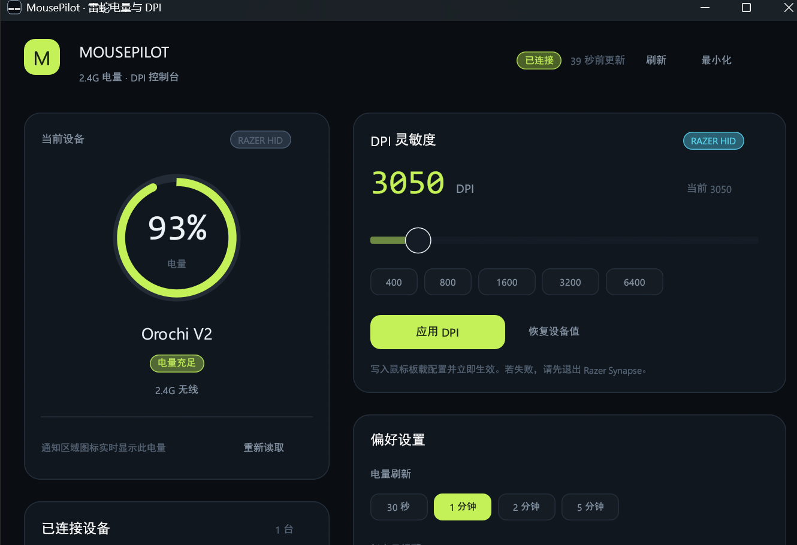

# MousePilot

一个用 Rust 编写的 Windows 鼠标小工具：读取 2.4G 无线鼠标电量，把两位数电量直接画进任务栏通知区域图标，并在界面里调整雷蛇鼠标 DPI。

界面使用 `egui / eframe`，设备通信直接调用 Windows HID API，不依赖 Razer Synapse、不需要管理员权限、不联网。




## 功能

- **电量读取**
  - 雷蛇 2.4G / 有线鼠标：通过雷蛇 HID 控制协议读取电量、充电状态。
  - 其它支持标准 HID Battery Strength（Usage Page `0x06`, Usage `0x20`）的 2.4G 鼠标：自动兜底读取。
  - 每 30 秒～5 分钟自动刷新，也可手动刷新。
- **任务栏电量图标**
  - 通知区域图标直接显示当前鼠标电量数字，例如 `87`；低电量变红，充电时变蓝。
  - 悬停提示包含设备名、电量、充电状态。
  - 图标是动态生成的位图，不依赖外部图片资源。
- **DPI 调整**
  - 读取雷蛇鼠标当前 DPI，100–45000 范围滑块 + 400/800/1600/3200/6400 快捷值。
  - 通过雷蛇板载配置写入，立即生效；写入后重新读取实际值。
- **桌面体验**
  - 关闭窗口时最小化到任务栏，通知区域图标持续显示电量；托盘菜单可打开、刷新、退出。
  - 多设备切换，记住上次选择。
  - 低电量阈值、刷新频率、开机自启均可设置。
  - 单文件 exe，绿色运行。

## 构建

要求：

1. Windows 10/11 x64。
2. Rust stable（<https://rustup.rs>）。
3. Visual Studio 2022 Build Tools，勾选 **使用 C++ 的桌面开发**（提供 MSVC 链接器）。

```powershell
# 在项目目录
.\build.ps1
# 或双击 build.bat
```

生成：

```
dist\MousePilot.exe
```

调试构建：

```powershell
.\build.ps1 -DebugBuild
cargo run
```

直接使用 Cargo：

```powershell
cargo build --release
.\target\release\mousepilot.exe
```

## 使用

1. 插入鼠标的 2.4G 接收器，或直接用 USB 线连接鼠标。
2. 启动 `MousePilot.exe`。首次扫描通常 1–3 秒。
3. 程序会自动选择电量可读的设备；多设备时在“已连接设备”中切换。
4. 点右上角“最小化”或直接关闭窗口，程序会最小化到任务栏，通知区域图标继续显示电量。
5. 需要退出时，右键通知区域图标 →“退出 MousePilot”。

`--tray` 参数会以隐藏窗口方式启动，开机自启项使用该参数。

设置保存在：

```
%APPDATA%\MousePilot\settings.json
```

开机自启写入当前用户的：

```
HKCU\Software\Microsoft\Windows\CurrentVersion\Run
```

不会写入系统目录，也不需要管理员权限。

## 设备兼容性说明

### 雷蛇

电量读取使用雷蛇通用的 90 字节 HID Feature Report：

- 电量：Command Class `0x07` / Command ID `0x80`，电量值在返回参数 `arg[1]`，按 `0–255 → 0–100%` 换算。
- 充电：`0x07` / `0x84`。
- DPI 读取：`0x04` / `0x85`。
- DPI 写入：`0x04` / `0x05`，X/Y 同时写入。
- 校验：对 payload 第 2–87 字节做 XOR，放在第 88 字节。

不同型号的事务 ID 不同，程序会依次尝试 `0x1F / 0x3F / 0xFF`，并自动选择能正常应答的控制集合。DPI 写入优先使用板载存储（VARSTORE），部分老型号可能只支持 NOSTORE 或单字节 DPI 命令，此时界面会给出失败提示。

> 现代雷蛇鼠标通常可用。极老的型号（如 DeathAdder 3.5G、部分 Naga Hex）使用不同的 DPI 字节格式，本项目未覆盖。

### 非雷蛇 2.4G 鼠标

只支持**向 Windows 暴露标准 HID Battery Strength** 的设备。程序会解析 Feature Report 或最近一次 Input Report 中的 `0x06/0x20` 字段。

如果厂商使用私有协议（例如罗技 HID++、部分 Nordic/ATK/VXE 私有帧），Windows 标准 HID 层不会提供电量，本项目也不会凭空读出来；这类设备会显示“未发现支持电量读取的鼠标”。

### 已知限制

- Razer Synapse 可能独占 HID 控制接口。若电量可读但 DPI 写入失败，先退出 Synapse。
- 鼠标休眠时接收器可能不回包。移动鼠标唤醒后点“刷新”。
- 标准 HID 设备只读，不提供 DPI 调整。
- 任务栏显示指 Windows **通知区域**（系统托盘），不是任务栏按钮上的叠加徽标。
- Windows 11 可能把新图标放进通知区域的折叠菜单。若希望常显，请在任务栏设置中把 MousePilot 设为显示。
- 电量百分比由设备固件上报。部分鼠标只上报 25/50/75/100 档位，会显示对应的近似值。

## 项目结构

```
src/
  main.rs       入口、窗口配置
  app.rs        egui 界面与交互状态
  engine.rs     后台扫描线程、设备命令
  hid.rs        SetupAPI/HID 枚举、标准电量读取、Feature Report
  razer.rs      雷蛇 90 字节协议、电量/充电/DPI
  model.rs      设备数据模型
  icon.rs       电量数字位图与托盘图标
  tray.rs       托盘图标、菜单、事件
  theme.rs      配色、字体、圆角卡片
  settings.rs   JSON 设置
  autostart.rs  HKCU Run 开机自启
build.ps1      发布构建
build.bat      双击构建
```

## 隐私

- 没有任何 HTTP、Socket、遥测或上传代码。
- 不读取、不保存鼠标序列号到日志；序列号只在内存中用于区分设备。
- 设置文件仅包含界面偏好。

## 备注

协议实现参考了 OpenRazer 社区公开的雷蛇 HID 协议知识（90 字节报告、命令号与 DPI 编码）。本项目是独立 Rust 实现，不包含 OpenRazer 源代码。

开发过程中已在 **Razer Orochi V2（2.4G，VID:PID `1532:0094`）** 上验证：

- 电量读取：`0xF0 → 94%`（测试时读数在 93–94% 之间波动）；
- DPI 读回：`3050`；
- DPI 写入：`1600` 与 `3050` 均写入成功并读回确认；
- 通知区域图标显示实测电量（截图时为 `93`）。

其它型号的固件行为可能不同；按需求未编写自动化测试。首次使用建议先运行调试构建，便于观察具体错误。
